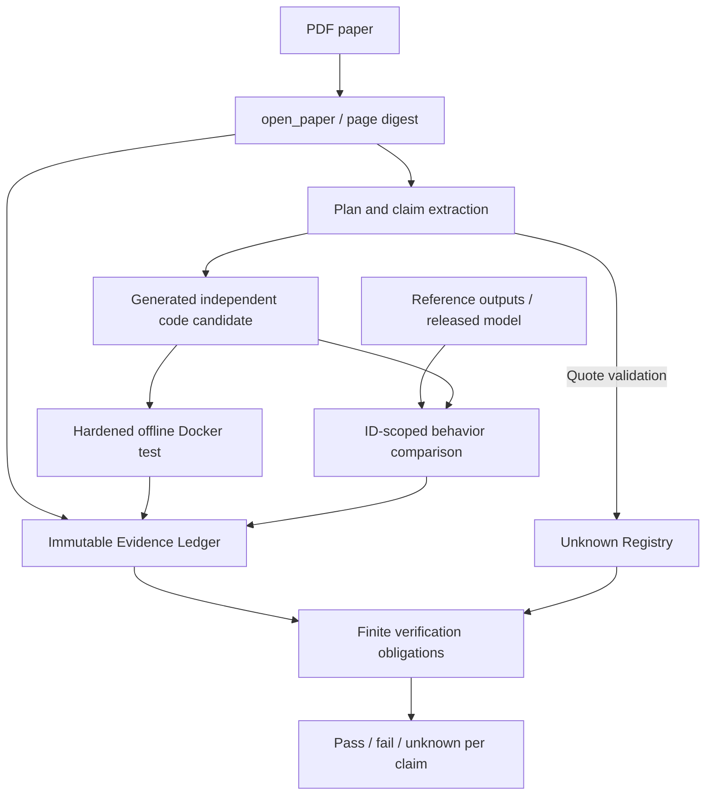

# REA architectural mapping and intentional scientific differences

REA (https://github.com/morluto/rea) uses separate target adapters, canonical content-addressed Evidence, an Unknown registry, MCP tool contracts, cautious scope-aware comparison and proof obligations. PaperRev follows **that architectural pattern with newly written code**, not a port of REA's binary/JS providers.

## Data flow

The application owns immutable Evidence records, model/source authority and the candidate lifecycle. The CLI and MCP tools are adapters, not separate math/science truth sources.

### Architectural boundaries

- `src/paperrev/workbench.py`: persistent session, content-addressed Evidence, exact SHA verification and revisioned residual unknowns.
- `src/paperrev/replicate.py`: PDF source reader, plan/quote checking, opt-in LLM client and path-bounded code candidate creation.
- `src/paperrev/reproduce.py`: Docker-only candidate test execution, output comparison and scoped claim verification.
- `src/paperrev/engine_cli.py`: programmatic dispatcher for reproducible local workflows.
- `src/paperrev/mcp_server.py`: discoverable MCP tools for coding agents; domain behavior is shared with CLI.
- `src/paperrev/startlux.py`: earlier StartLux research adapter; **not** the generic system core.

### Evidence record

All Evidence records bind `kind`, `authority`, `confidence`, `subject`, `result`, `sources`, `coverage`, `limitations` into the SHA256 Evidence ID. Corrupting an Evidence file invalidates its claimed identity. Repeated identical evidence is idempotent; incompatible records cannot reuse the same ID. Linked parent Evidence IDs must exist and validate.

`coverage` identifies the observed scope, not global software or scientific completeness. `reported` and `inferred` are never silently promoted to `observed`. Export bundles contain Evidence and current unknowns with authenticated links, but not the underlying PDF, weights or source code.

### Why not use REA itself for every paper?

REA natively studies shipped binaries, browser applications, static JavaScript and captured processes. Most paper-specific scientific obligations concern formulas, training objectives, datasets, seeds, ablations and observed model behavior. Our tool borrows the investigative discipline but uses its own source/experiment adapters. An external REA installation can still be used when a released compiled application is the target.

## What is implemented now versus later

Implemented: manual or LLM-proposed plan with quote validation, independent candidate code generation, syntax checks, immutable Evidence/unknowns, bounded Docker tests, output comparison, per-claim checks, CLI and MCP interface.

Not yet implemented: reliable automatic extraction/interpretation of figures; an arbitrary high-fidelity PyTorch checkpoint runner; GPU-job scheduling; mathematical theorem proving; downloading pretrained weights; LoRA/RLCD² training; fully automated integration with PaperBench rubric graders; comprehensive independent scientific verification. The generic agent can *propose* implementations, but their accuracy depends on the evidence, coding model and testing budget.

## Design principle

A passing generated unit test is evidence about that unit test, not about the original author's code or paper. An observed equality on a particular input set is not proof of general equivalence. Absence in a partial PDF/page sample is unknown, not an observed negative finding.
